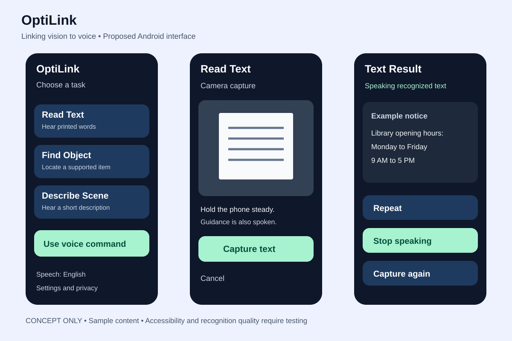
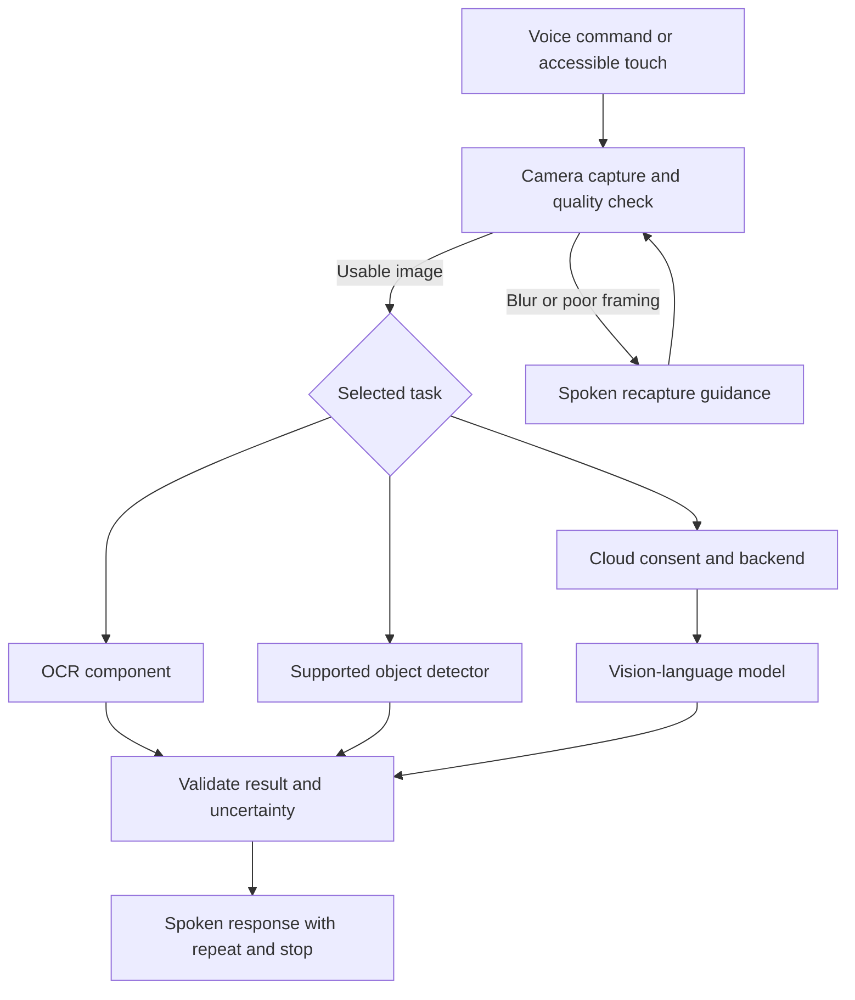

# OptiLink
### Linking vision to voice

**An AI visual assistant for blind and low-vision people**

OptiLink is a proposed Android application that turns captured visual information into spoken assistance. It brings printed-text reading, common-object identification, and scene descriptions into one accessible workflow.

**Competition:** International AI Competition  
**Category:** Intelligent App Creation  
**Proposed by:** Muhammad Saim Naveed  
**Status:** Proposal and design stage

> This repository contains the project proposal, concept designs, and implementation/evaluation plans. A working application, trained models, measured results, and an APK are not yet available.

## Project proposal

Read the [full project proposal](OptiLink_Project_Proposal.md) for the objectives, scope, timeline, resources, and limitations.

## Core modes

| Mode | Intended interaction | Intended response |
| --- | --- | --- |
| Read Text | “Read this notice,” then capture an image | Recognized printed text spoken aloud |
| Find Object | Request a supported item, then capture an image | Approximate left, center, or right position in the image |
| Describe Scene | Capture a scene and request a description | A concise description of visible objects and activities |

English is the initial prototype language. Urdu support, offline processing, and follow-up questions are extensions subject to feasibility and quality testing.

## Proposed interface design

These are illustrative concept screens, not screenshots from an implemented application. The result screen uses fictional sample text.

The planned interface supports spoken capture guidance, Android TalkBack labels, logical focus order, large controls, high contrast, adjustable text, and immediate repeat/cancel/stop actions. Intended users will help refine and test the design.

## Proposed architecture

- **Android client:** Kotlin, camera capture, accessible controls, speech recognition, and text-to-speech.
- **Recognition:** OCR and a mobile-compatible pretrained object detector, selected after testing.
- **Scene description:** Optional cloud model accessed through a backend that protects API credentials and limits requests.
- **Privacy:** Local processing where feasible, explicit consent before cloud processing, and no default image retention.
- **Failure handling:** Recapture prompts, uncertainty responses, timeouts, and local fallback where supported.

Exact providers, model versions, supported object classes, and offline capabilities remain to be selected and evaluated.

## Development roadmap

| Period | Planned milestone |
| --- | --- |
| Week 1 | User needs, requirements, and evaluation plan |
| Week 2 | Accessible Android application shell |
| Weeks 3–4 | OCR and supported-object modes |
| Week 5 | Scene descriptions and uncertainty handling |
| Week 6 | Error handling, connectivity fallback, and Urdu feasibility |
| Week 7 | Supervised accessibility testing and revisions |
| Week 8 | Verification, documentation, and demonstration |

## Evaluation and demonstration

The [evaluation and demonstration plan](docs/evaluation-plan.md) defines proposed checks and example scenarios. Targets are planning goals; no performance claims have been validated.

## Scope and limitations

OptiLink supports access to visual information. It does not replace a white cane, guide dog, or mobility training. Object positions are relative to a captured image, not reliable physical distances or safe routes.

The proposed prototype excludes road-crossing advice, medication decisions, currency authentication, and identifying strangers.

## Repository materials

| File | Purpose |
| --- | --- |
| [Project proposal](OptiLink_Project_Proposal.md) | Complete competition proposal |
| [Interface concept](assets/optilink-interface-concept.svg) | Three proposed Android screens |
| [Design notes](docs/design-notes.md) | Interaction and accessibility requirements |
| [Evaluation plan](docs/evaluation-plan.md) | Testing targets and demonstration scenarios |

There are no installation instructions yet because implementation has not started.
